# Hey, I'm João 👋

## What I'm up to

I'm a builder at **[Addy AI](https://addy.so)**, an AI platform that does the paperwork mortgage
loan officers and processors would rather not. Most of my day lives in private repos, which is why
the green squares look like that.

- 🤖 **AI agents** that read loan files, check them against guidelines and draft the next email
- 🔌 **MCP servers** that let ChatGPT, Claude and friends work with a loan pipeline
- 📄 **Document parsing (OCR)**, **voice agents** and a **Chrome extension** for loan officers
- 🦾 **Adele**, a humanoid robot that answers mortgage questions at trade shows (yes, really)
- 🗺️ On the side: **Hereabouts**, travel planning with route optimization, and an AI manga reader

## By the numbers

<picture>
  <source media="(prefers-color-scheme: dark)" srcset="assets/stats-dark.svg">
  
</picture>

<picture>
  <source media="(prefers-color-scheme: dark)" srcset="assets/yearly-dark.svg">
  
</picture>
<picture>
  <source media="(prefers-color-scheme: dark)" srcset="assets/monthly-dark.svg">
  
</picture>

<picture>
  <source media="(prefers-color-scheme: dark)" srcset="assets/languages-dark.svg">
  
</picture>
<picture>
  <source media="(prefers-color-scheme: dark)" srcset="assets/weekday-dark.svg">
  
</picture>

The same numbers as a table

<!-- STATS-TABLE:START -->
| Stat | Value |
|---|---|
| All-time contributions | 16,341 |
| Contributions in 2020 | 1 |
| Contributions in 2021 | 30 |
| Contributions in 2022 | 728 |
| Contributions in 2023 | 447 |
| Contributions in 2024 | 1,244 |
| Contributions in 2025 | 3,319 |
| Contributions in 2026 | 10,572 |
| Pull requests merged | 3,548 |
| Longest streak | 34 days |
| Current streak | 12 days |
| Busiest day | 333 on Oct 28, 2026 |
| Repositories contributed to | 22 |
| Language: TypeScript | 53.0% |
| Language: Python | 13.1% |
| Language: CSS | 12.7% |
| Language: HTML | 10.2% |
| Language: JavaScript | 9.7% |

Last refreshed 2026-11-06.
<!-- STATS-TABLE:END -->

## Tools I reach for

 

 

## Contribution snake

<picture>
  <source media="(prefers-color-scheme: dark)" srcset="https://raw.githubusercontent.com/hereisabrams/hereisabrams/output/snake-dark.svg">
  
</picture>

Every square it eats is a day I did not touch grass.

---

Charts are drawn by <a href="scripts/generate.mjs">scripts/generate.mjs</a> and refreshed every day by a GitHub Action in this repo.

